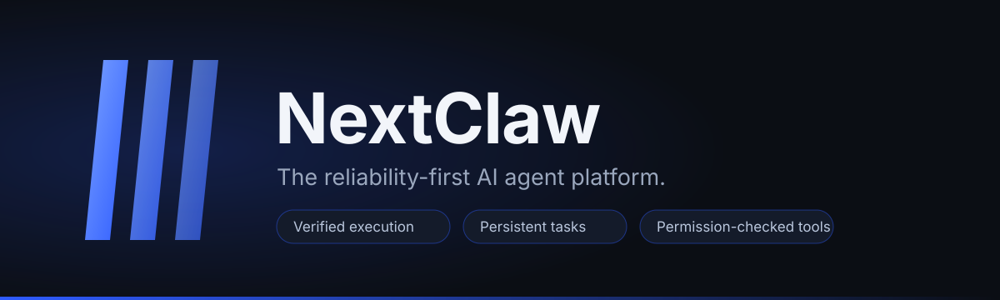
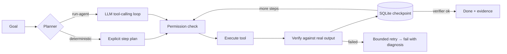

<p align="center">
  
</p>

<p align="center">
  <a href="https://github.com/muteebdeva/nextclaw/actions/workflows/ci.yml"></a>
  
  
  
</p>

# NextClaw

**The reliability-first AI agent platform.** NextClaw runs AI agents that plan,
use tools, and *prove* their work: every task has explicit success criteria,
every step is verified against real tool output, and every run is checkpointed
to SQLite so interrupted tasks resume instead of restarting.

```bash
git clone https://github.com/muteebdeva/nextclaw.git
cd nextclaw
python3 -m nextclaw.cli init
python3 -m unittest discover -s tests   # offline suite, no API key needed
```

## What makes it different

Most agent frameworks trust the model's word. NextClaw doesn't:

- **Verified execution** — a task is only "done" when a verifier confirms the
  result against recomputed evidence (not when the model says so).
- **Persistent autonomy** — tasks survive crashes and restarts via SQLite
  checkpoints; resume never repeats completed work.
- **Permission-checked tools** — allowlisted tools, workspace confinement,
  destructive-command denylist, secret redaction, and human approval for
  high-risk actions.
- **Quota-safe by design** — API budgets, exhaustion cooldowns, and an offline
  mode protect shared keys.

## Web dashboard (new)

NextClaw ships a real control plane — no terminal required:

```bash
python3 -m nextclaw.cli serve
# → http://127.0.0.1:8765  (paste the printed API token to unlock)
```

- **Overview** — mission control: prominent New Mission action, live active
  work with current steps, needs-attention (pending approvals, failed
  tasks), recent results with verification flags, quota, scheduler,
  provider health
- **Tasks** — create (deterministic or model-driven), filter, inspect the
  execution timeline, tool calls with arguments/outputs, and verification
  evidence; cancel or resume from checkpoints. Failed tasks show a
  classified diagnosis (timeout, auth, provider, verification, step
  failure) instead of a raw error string
- **Multi-Agent** — launch delegated missions across specialist worker
  agents, monitor the dependency graph live, inspect worker outputs,
  cancel or retry failed subtasks, enable/disable delegation
- **Approvals** — pending high-risk actions with full context; approve or
  reject; every decision lands in the audit log
- **Scheduler** — jobs, next runs, run history, enable/disable/run-now
- **Providers** — Gemini/Ollama status, connectivity tests, safe config
  (keys stay in environment variables and are never shown)
- **Settings** — workspace, execution limits, permission policy, theme

The UI is a dependency-free single-page app (`nextclaw/web/`) backed by a
JSON API (`nextclaw/server.py`, stdlib only) with Bearer-token auth,
per-IP rate limits, and Server-Sent Events for live task updates.
See [docs/DEPLOYMENT.md](docs/DEPLOYMENT.md) before exposing it beyond
localhost.

## Quickstart: a verified agent run

No API key needed — the deterministic planner runs fully offline:

```bash
python3 -m nextclaw.cli --workspace . run \
  --goal "Count the Python files and write a verified report" \
  --type file_report \
  --param root=nextclaw --param pattern='**/*.py' \
  --param output=reports/quickstart.md
```

The agent plans 4 steps (collect → measure → write → verify), executes each
through the permission system, checkpoints to SQLite, then **recomputes the
measurements** and compares them against the report's claimed totals:

```json
{
  "report_path": "reports/quickstart.md",
  "sha256": "e5e9dabade42914a9f75f10b1d8108e3dc845537df81ec284d519372b62e0996",
  "total_files": 13,
  "total_lines": 2791,
  "verified": true
}
```

## Real-model agents (`run-agent`)

With an API key, the model itself reasons, picks tools, and inspects real
outputs in a tool-calling loop:

```bash
export NEXTCLAW_GEMINI_API_KEY="your-key-here"
python3 -m nextclaw.cli run-agent \
  --goal "Count the Python files under src and write a verified report to reports/r.md" \
  --verify-tool verify.file_report \
  --verify-arg report_path=reports/r.md \
  --verify-arg root=src --verify-arg pattern='**/*.py'
```

Every turn is persisted, so `resume --task-id <id>` continues an interrupted
run from the saved conversation. If the verifier reports `ok:true`, the loop
stops on the explicit success criterion instead of second-guessing it.

### Providers

NextClaw is provider-agnostic — the agent loop talks to a normalized
interface, and you switch models through configuration, never code edits:

| Adapter | Covers |
|---|---|
| OpenAI-compatible | OpenAI, Azure OpenAI, Groq, OpenRouter, DeepSeek, Mistral, xAI, Together, Fireworks, Cerebras, GitHub Models, Hugging Face, LM Studio, llama.cpp, LocalAI, vLLM, custom endpoints |
| Anthropic | Claude via native Messages API |
| Gemini | Google AI Studio via native function calling (verified working) |
| Ollama | Local models via native `/api/chat` |
| Bedrock | AWS Bedrock Converse API (SigV4, stdlib) |

Add providers in the dashboard (**Providers** page: add, test, send a test
prompt, set default, order fallbacks), via the API
(`POST /api/providers/configs`), or the CLI:

```bash
python3 -m nextclaw.cli providers presets
python3 -m nextclaw.cli providers test --name my-openai
```

Keys live in environment variables (preferred, e.g. `OPENAI_API_KEY`) or the
server-side store — never in the frontend, never in full in any API
response. See [docs/PROVIDERS.md](docs/PROVIDERS.md) for the full guide,
including local-model setup, custom endpoints, fallbacks, and the LiteLLM
evaluation.

## How it works



- **Planning** — `run` uses an explicit deterministic planner; `run-agent`
  lets the model plan in its own words via function calling.
- **Tools** — 9 built-ins: `fs.list`, `fs.read`, `fs.write`, `fs.hash`,
  `fs.measure`, `browser.fetch`, `verify.file_report`, `verify.file_write`,
  `exec.run`. All run through one permission policy.
- **Deterministic task types** — `file_report`, `file_write`,
  `browser_research` (each with explicit success criteria and verifiers),
  plus open-ended `run-agent` goals with a configured model.
- **Verification** — verifiers recompute results independently. A wrong report
  fails the task with a diagnosis; the model can read the error and try again.
- **Checkpoints** — task state, steps, and conversation turns persist after
  every tool call. Crash recovery is tested, not assumed.
- **Safety rails** — bounded turns (default 12), bounded retries (3),
  task deadlines, per-task and daily API budgets, approvals for high-risk
  tools, secret redaction on all tool output.

## Autonomous dev cycles

A persistent scheduler runs the test suite and records project state every
40 minutes:

```bash
python3 -m nextclaw.cli scheduler ensure   # create the 40-minute job
python3 -m nextclaw.cli scheduler start    # start the daemon
python3 -m nextclaw.cli scheduler status   # jobs, next runs, last outcomes
python3 -m nextclaw.cli scheduler run-now  # manual trigger
python3 -m nextclaw.cli scheduler stop
```

State survives restarts; overlapping runs are impossible by atomic claim;
stale runs are marked `interrupted` on recovery. Scheduler cycles never call
the LLM, so they burn no quota.

## Project structure

```
nextclaw/
  nextclaw/
    agent.py        # deterministic planner + verified executor
    agent_llm.py    # live-model tool-calling loop
    llm.py          # provider abstraction (Gemini, Ollama) + quota budgets
    tools.py        # tool registry, permissions, sandbox, secret redaction
    browsertools.py # SSRF-guarded web fetching (read-only research)
    approvals.py    # human approval gate + audit log
    channels.py     # Telegram channel (opt-in, mock-tested)
    server.py       # dashboard API + static server (stdlib only)
    web/            # dashboard SPA (index.html, styles.css, app.js)
    tasks.py        # SQLite task queue + step state machine + turns + events
    memory.py       # structured long-term memory with provenance
    scheduler.py    # persistent 40-min dev-cycle scheduler
    bench.py        # reproducible benchmark suite
    cli.py          # command-line interface
    cycle.py        # autonomous dev-cycle runner
  tests/            # offline unit suite (mocked) + env-gated live smoke tests
  docs/             # deployment guide + provider guide
  examples/demo.py  # self-contained end-to-end demo (temp dirs only)
  assets/           # logo, banner, social preview (SVG)
  .github/          # CI, issue/PR templates
```

## Configuration

| Variable | Default | Purpose |
|---|---|---|
| `NEXTCLAW_DATA_DIR` | `~/.nextclaw` | SQLite state, logs |
| `NEXTCLAW_WORKSPACE` | `~/workspace` | agent workspace root (tools are confined here) |
| `NEXTCLAW_MODEL_PROVIDER` | `stub` | deterministic planner provider |
| `NEXTCLAW_LLM_PROVIDER` | `gemini` | legacy default; auto-migrated to a provider config on first run |
| `NEXTCLAW_LLM_MODEL` | `gemini-3.7-flash` | legacy model; auto-migrated |
| `NEXTCLAW_GEMINI_API_KEY` | — | Gemini key (also: `OPENAI_API_KEY`, `ANTHROPIC_API_KEY`, `GROQ_API_KEY`, … — see [docs/PROVIDERS.md](docs/PROVIDERS.md) for the full env map) |
| `NEXTCLAW_OLLAMA_URL` | `http://127.0.0.1:11434` | legacy Ollama URL; auto-migrated |
| `NEXTCLAW_OLLAMA_MODEL` | — | legacy Ollama model; auto-migrated |
| `NEXTCLAW_LLM_TIMEOUT_S` | `60` | per model-call timeout |
| `NEXTCLAW_LLM_MAX_PER_DAY` | `200` | daily API request cap |
| `NEXTCLAW_OFFLINE` | — | set to `1` to disable all model calls |

Copy `.env.example` to `.env` for a documented starting point (never commit
real keys).

## Testing

```bash
python3 -m unittest discover -s tests          # full offline suite (mocked; live tests auto-skip)
python3 -m unittest tests.test_providers_live -v   # live provider smoke tests (needs config, see below)
NEXTCLAW_LIVE_TESTS=1 python3 -m unittest tests.test_llm_live   # legacy live agent test, needs API key
python3 examples/demo.py                        # end-to-end demo in temp dirs
python3 -m nextclaw.cli bench                   # benchmark suite
```

Test tiers:

- **Unit tests** (`tests/`, offline): mocked providers, real HTTP against a
  local test server, no network, no credentials. This is what CI runs.
- **Live provider smoke tests** (`tests/test_providers_live.py`): call a real
  configured provider — auth check, tiny generation, tool calling where
  supported. Run only with `NEXTCLAW_LIVE_SMOKE=1` plus:
  `NEXTCLAW_SMOKE_ADAPTER` (`openai_compat`/`anthropic`/`gemini`/`ollama`/`bedrock`),
  `NEXTCLAW_SMOKE_MODEL`, and for cloud adapters `NEXTCLAW_SMOKE_API_KEY`
  (`NEXTCLAW_SMOKE_BASE_URL` for custom/local endpoints). Without
  configuration they report **skipped**, never passed. Keys are never logged.
  Also runs weekly via `.github/workflows/live-smoke.yml` (plus manual
  dispatch) using repository secrets.
- **Skipped tests** are env-gated live tests, reported as skipped — not passed.

Reproducible count: `python3 -m unittest discover -s tests 2>&1 | tail -3`

CI runs the suite on Python 3.10–3.12. The live-model test is skipped by
default so CI and contributors never burn quota.

## Troubleshooting

| Symptom | Cause / fix |
|---|---|
| `no usable AI provider configured` | add a provider in the dashboard (Providers) or export a key, e.g. `NEXTCLAW_GEMINI_API_KEY` |
| `Gemini provider needs NEXTCLAW_GEMINI_API_KEY` (legacy path) | export the key, or use offline `run` |
| `quota cooldown active` | free-tier quota exhausted; wait or raise `llm_quota_cooldown_s` |
| `approval required for tool 'exec.run'` | resume with `--approve exec.run` after reviewing, or approve in the dashboard |
| `path escapes workspace root` | tools are confined to `NEXTCLAW_WORKSPACE` by design |
| `did not finish within 12 turns` | raise `max_turns`, or simplify the goal |
| dashboard asks for a token | paste the token printed by `nextclaw serve` (or set `NEXTCLAW_API_TOKEN`) |

## Security

- No secrets in code, docs, or git history — keys come only from the
  environment. See [SECURITY.md](SECURITY.md).
- Tool outputs are redacted for secret-like patterns before the model sees them.
- `exec.run` never uses a shell, is denylisted for destructive patterns, is
  confined to the workspace, and requires explicit human approval.
- Unconfigured providers fail closed with a clear error.
- The dashboard API requires a Bearer token; keys are never exposed by any
  endpoint; browser fetching is SSRF-guarded. See
  [docs/DEPLOYMENT.md](docs/DEPLOYMENT.md).

## Messaging

An opt-in Telegram channel (`python3 -m nextclaw.cli channels telegram`)
maps messages to tasks: `/task <goal>`, `/status`, `/tasks`, `/cancel`.
Access is restricted to `NEXTCLAW_TELEGRAM_ALLOWED_IDS`, update offsets
persist (no duplicate tasks on restart), and approvals are never granted
from chat — they require the dashboard or CLI. Token via
`NEXTCLAW_TELEGRAM_BOT_TOKEN`. Any pre-existing bot is untouched.

## Roadmap

- [x] Verified deterministic task execution
- [x] Live-model tool-calling loop (Gemini; Ollama implemented)
- [x] Persistent 40-minute scheduler
- [x] Quota budgets and cooldowns
- [x] Web dashboard + API + human approvals
- [x] Task cancellation and audit log
- [x] Browser research (fetch-only; interactive browsing needs headless Chromium)
- [x] Telegram channel (opt-in)
- [x] Self-debugging coding agent (fs.edit, git tools, debug discipline, regression checks)
- [x] Interactive browser automation (CDP, stdlib-only; click/fill/select approval-gated)
- [x] Long-running background missions (pause/resume, budgets, idempotency, restart recovery)
- [x] Independent verification engine (acceptance criteria, pass/fail/inconclusive)
- [x] Multi-agent delegation (worker profiles, parallel DAG, artifacts, review)
- [ ] Cost/token accounting per task
- [ ] Head-to-head benchmark vs alternatives

See [ROADMAP.md](ROADMAP.md) for detail.

## Autonomous execution

NextClaw can now execute complex work independently:

**Coding agent.** `fs.edit` (surgical patches), `git.status`/`git.diff`
(read-only inspection), sandboxed `exec.run`, and a debugging discipline in
the agent prompt: explore → plan with acceptance criteria → smallest patch →
run tests → diagnose from real output → bounded retries → regression check.
`run-agent` tasks accept `acceptance_criteria` (list of `{criterion, method,
...}`); the loop verifies deterministically before finishing and routes
failures back for up to `verify_retries` (default 2) correction attempts.

**Browser automation.** `browser.open/snapshot/click/fill/select/wait/
screenshot/close` drive headless Chromium over CDP (stdlib only, no new
dependencies). Click/fill/select require approval. Page content is treated
as untrusted; cookies and credentials never enter prompts. Navigation
policy: `browser_navigate_allowlist` (empty = allow all http(s)),
`browser_allow_file` (default false).

**Background missions.** `nextclaw mission create/run/status/pause/resume/
cancel/list` manages durable multi-step missions with explicit states
(created → planning → running → verifying → completed, plus paused,
waiting_for_approval, failed, cancelled). Steps checkpoint to SQLite,
survive restarts (running steps reset; completed actions never repeat via
idempotency keys), honor per-mission budgets (steps, tool calls, runtime),
and gate approval-required tools through the existing approval store.

**Verification engine** (`nextclaw/verify.py`). Deterministic checkers for
`tests` (exit code), `files` (existence + content), `command` (exit +
output), and `browser` (page state). Uncheckable criteria are
**inconclusive**, never passed. Used by missions and the agent loop.

## Multi-agent delegation

For complex multi-part work, the lead agent can delegate to specialized
workers via the `delegate` tool (or a mission step):

```python
# Worker profiles: researcher, planner, coder, tester, reviewer
# (extensible via delegation.register_profile)
```

- Independent subtasks run **in parallel** (bounded concurrency);
  dependencies are respected; cycles are rejected.
- Workers are regular agent tasks with profile-specific system prompts and
  restricted tool allowlists — they never inherit extra permissions.
- Structured handoffs (`WorkerResult`): status, summary, artifacts,
  evidence, errors, usage. Validated; worker outputs are untrusted data.
- Shared artifacts with provenance + versioning (`artifacts/<worker>/`).
- Failure recovery: retryable errors retried (bounded); failed subtasks
  fail their dependents without wasted work; no blind full restarts.
- Independent reviewer can request revisions within a bounded round budget.
- Global budgets: max workers, concurrency, depth, model calls, runtime,
  retries. Cancellation propagates to workers.
- Dashboard: the **Multi-Agent** section (`#/agents`) configures, launches,
  monitors and manages missions through the UI — no CLI needed:
  - **New mission**: mission goal, planning mode (manual subtask editor or
    automatic planner worker), per-subtask specialist role (researcher,
    planner, coder, tester, reviewer), dependencies, acceptance criteria,
    retries, and budgets (max workers, concurrency, model calls, runtime,
    depth). Workers run with the dashboard's default provider chain.
  - **Mission list**: live status, subtask progress, resource usage.
  - **Mission detail**: worker table with roles, statuses, dependencies,
    attempts, summaries and errors; per-worker inspection (instructions,
    criteria, evidence, artifacts, link to the worker task); promoted
    artifacts; verification report; cancel and retry-failed-subtasks
    controls; "launch plan as mission" for completed planner workers.
  - **Delegation settings**: enable/disable launching new missions.
  - Approvals raised by workers appear in the existing **Approvals** queue.
  - API: `GET/POST /api/delegations`, `GET /api/delegations/<id>`,
    `POST /api/delegations/<id>/cancel|/retry`,
    `GET /api/delegations/profiles`, `GET/PUT /api/delegations/settings`.
- Simple tasks stay on the single-agent path.

## Contributing

Bug reports and pull requests are welcome. Please read
[CONTRIBUTING.md](CONTRIBUTING.md) first — it covers the test suite, how to add
tools and providers, and the no-fabrication rule: every claim needs a test.

## License

MIT — see [LICENSE](LICENSE).

---

*Built with zero dependencies — Python's standard library only.*
